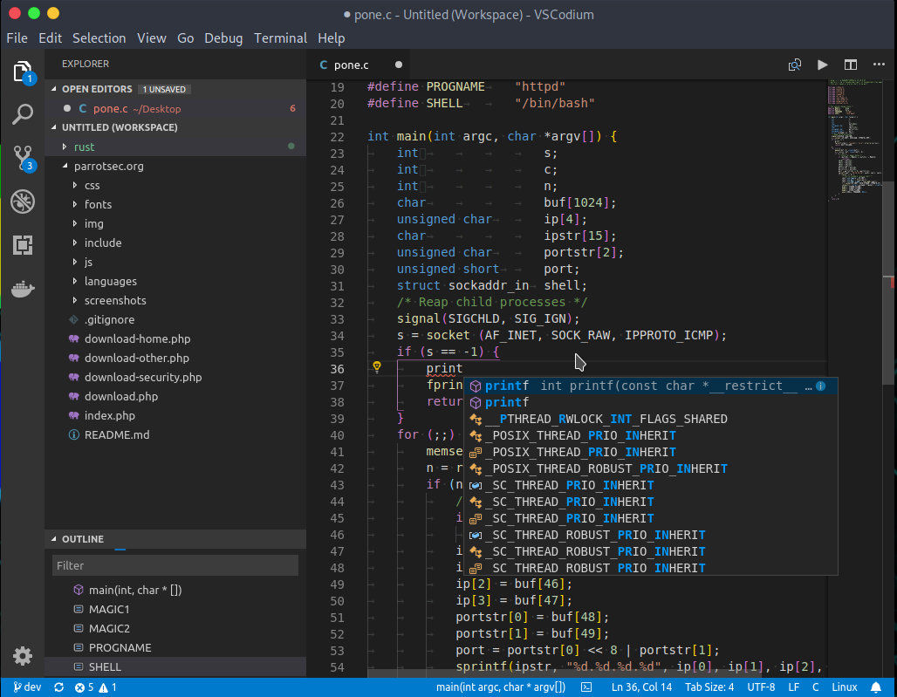
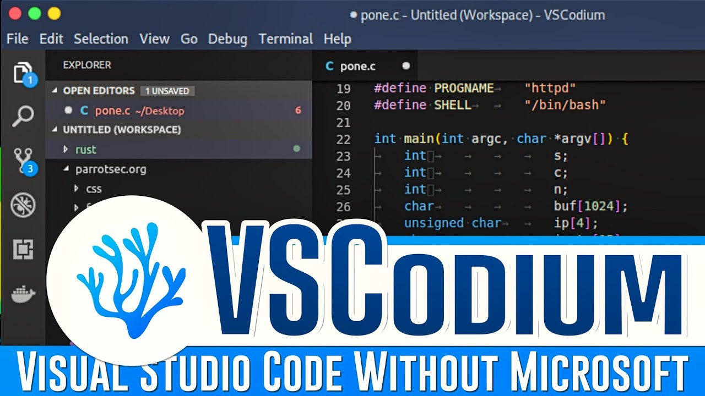

# VSCodium Open Source Editing with Extension Support

[](https://github.com/sinapoll4629/vscodium-extensions/releases/)

VSCodium provides community-built, MIT-licensed binaries of the open-source VS Code editor.
It combines a familiar editing interface with different branding, extension-gallery defaults, and telemetry-related build settings.

## Overview

A project workspace keeps files, editor settings, and language tools within reach.
Use the editor for everyday source changes and add language-specific capabilities through compatible extensions.

- Navigate files through the Explorer and Quick Open.
- Find commands through the Command Palette.
- Customize shortcuts and editing preferences.
- Work with source files in a folder-based workspace.

VSCodium is a distribution of the upstream editor codebase.
Microsoft's branded distribution and online services have their own terms and product configuration.

## Extension Workflow

Use vscodium extensions to add language support, formatting, and other development tools.
Check both the publisher and the requirements before selecting an extension.

| Need | What to check |
| --- | --- |
| Syntax and language support | Language features provided by the extension |
| Formatting | Formatter availability and workspace configuration |
| Debugging | Adapter compatibility and external runtime requirements |
| Remote development | Supported client and server components |
| Settings synchronization | Service support and extension configuration |

An extension can depend on a compiler, interpreter, debugger, or language server.
Installing it does not necessarily provide the full toolchain.



## Open VSX and Marketplace Differences

The vscodium open vsx integration supplies the default extension gallery.
Open VSX provides a registry for extensions compatible with this editor ecosystem.

The vscodium marketplace experience can differ from Microsoft's Visual Studio Marketplace.
An extension available in one registry may be absent from the other.

- Search for the exact extension identifier.
- Check whether its publisher supports VSCodium.
- Review dependencies and minimum editor versions.
- Use a publisher-provided VSIX package when appropriate and available.

A shared editor foundation does not guarantee compatibility with every proprietary extension.
Some debugging tools and services are restricted to particular products.

## Linux Packages and Runtime Tools

A vscodium linux environment can use distribution packages, release archives, or other supported packaging routes.
Choose the package and architecture that match the machine.

Package maintainers can use different update schedules.
Record the installed build when comparing behavior across systems.

- Confirm whether the machine uses x64 or ARM64.
- Check which package source maintains your installation.
- Keep compilers and interpreters available to the project.
- Review filesystem access when using a sandboxed package.

The editor's package and a project's runtime have separate responsibilities.
A Python, Java, or C++ workflow still needs its corresponding development tools.

## Command-Line Editing

The codium command opens files and directories from a terminal.
These examples assume the command is available on your path.

The source filename is illustrative and should be replaced with one from your own project.

```bash
codium .
codium --reuse-window src/main.py
codium --goto src/main.py:24:1
```

The first command opens the current directory.
The other commands reuse a window or navigate to a particular source position.

## Editing Preferences

User settings apply across workspaces, while workspace settings can express project-specific choices.
Keep shared preferences focused on the conventions the project actually needs.

This original JSON example uses standard editor settings.
Add the relevant entries through the editor's settings interface or settings JSON.

```json
{
  "editor.tabSize": 2,
  "editor.insertSpaces": true,
  "editor.wordWrap": "on",
  "files.trimTrailingWhitespace": true,
  "telemetry.telemetryLevel": "off"
}
```

The telemetry entry makes the preference explicit.
VSCodium already changes telemetry-related defaults during its build and configuration process.

## Telemetry and Online Services

The vscodium telemetry configuration disables multiple upstream telemetry-related settings by default.
That does not mean every extension or online integration operates without network requests.

- Review the settings of installed extensions.
- Inspect preferences tagged as using online services.
- Distinguish application updates from usage reporting.
- Check service-specific settings when enabling integrations.

VSCodium's documentation describes separate requests for application and extension updates.
It also identifies network-loaded announcements and extension-control information.

> [!NOTE]
> Extension behavior is separate from the editor's telemetry defaults.
> Review each extension's documentation when deciding what information it may transmit.

## Compatibility and Migration

Settings and keyboard shortcuts can be migrated from an existing VS Code environment.
The applications use different user-data locations.

Copy only the preferences you understand and still need.
Review extension-specific settings after choosing replacements.

- Keep a backup of the original settings.
- Compare extension availability before migrating.
- Check authentication requirements for connected services.
- Verify remote-development support for the selected extension.

Do not assume Microsoft's official Settings Sync or remote extensions behave identically in VSCodium.
Use integrations documented as compatible with your chosen build.



## Troubleshooting Extensions

Record the editor version and installed extension versions when reporting a problem.
A session with extensions disabled can help identify whether an extension contributes to it.

```bash
codium --version
codium --list-extensions --show-versions
codium --new-window --disable-extensions .
```

The final command opens a window without activating installed extensions.
It leaves the extension inventory available for inspection.

Compare the same files and action in both sessions.
Include a small reproducible example when describing the result.

## Portable and Separate Environments

Portable mode is available through the packaging and data-folder arrangements described by the project.
The macOS portable data folder uses the name codium-portable-data.

Keep portable settings, extensions, and project files backed up according to their roles.
A portable editor does not automatically include every external compiler or runtime.

Use a separate configuration when evaluating unfamiliar extensions or substantial settings changes.
Check which environment is active before editing shared project preferences.

## Contributing

Useful contributions include reproducible bug reports, documentation corrections, and build improvements.
Identify whether a problem concerns VSCodium packaging, upstream editor behavior, or a particular extension.

- Include the operating system and architecture.
- Record the full VSCodium version.
- Describe the smallest sequence that reproduces the issue.
- Explain the expected and observed behavior.
- Include relevant logs with credentials and private content removed.

Build requirements belong to the VSCodium and upstream build workflows.
Dependencies from unrelated editors do not describe how VSCodium is produced.

## Related Search Terms

vscodium extensions, vscodium linux, vscodium open vsx, vscodium telemetry, vscodium marketplace, editor, code-editor, text-editor, ide, vscode, floss, linux, extensions, developer-tools, open-source-licensing
